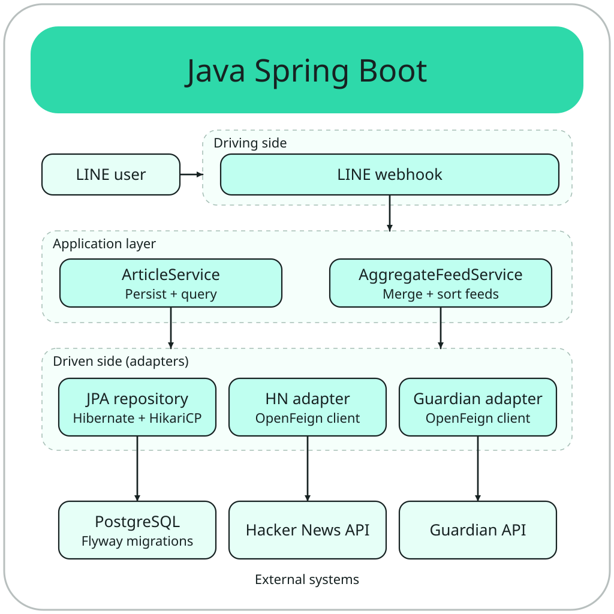
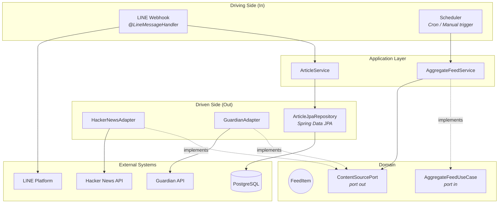
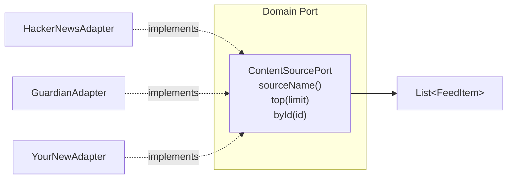
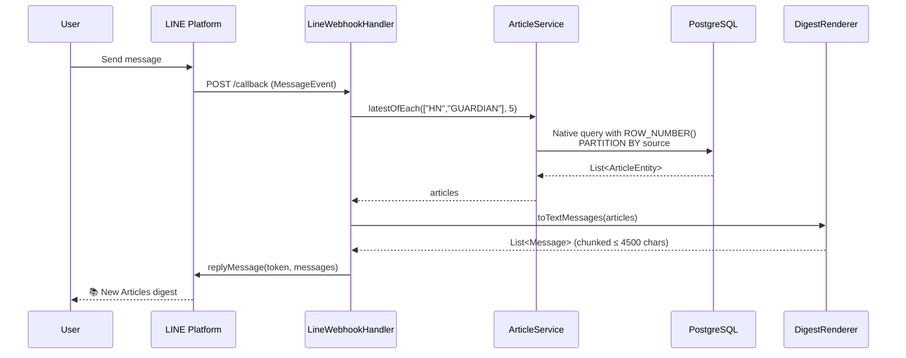

<div align="center">

# Briefly — News Ingestion and Aggregation Backend


<p align="center">
  
</p>

A Spring Boot backend service that aggregates content from multiple news sources (Hacker News, The Guardian) and delivers digests to users via a LINE Bot webhook. Built as a learning project to explore the Spring ecosystem and design pattern in depth.

The value isn't in "fetching news", but in how the pieces fit together via a design pattern
**JPA/Hibernate entity mapping, HikariCP connection pooling, Flyway migrations, Feign declarative HTTP clients, and hexagonal architecture with Spring's DI**.

</div>

## Tech Stack

| Layer | Technology |
|---|---|
| Framework | Spring Boot 3.5.5, Java 17 |
| Persistence | Spring Data JPA / Hibernate, PostgreSQL 16 |
| Connection Pool | HikariCP (Spring Boot default) |
| Migrations | Flyway |
| HTTP Clients | Spring Cloud OpenFeign |
| Messaging | LINE Bot SDK 9.11 (Webhook) |
| Security | Spring Security |
| Testing | JUnit 5, Testcontainers (PostgreSQL), Mockito |
| Infrastructure | Docker Compose |

## Architecture

The project follows **Hexagonal Architecture** (Ports & Adapters), keeping the domain logic completely decoupled from external concerns.

See the [Architecture Decision Records](adr/README.md) for technical choices and their rationale.



### Why Hexagonal?

The `ContentSourcePort` interface defines what the domain needs — a list of `FeedItem` objects — without caring whether they come from Hacker News, The Guardian, or any future source. Adding a new source means writing one adapter class; zero changes to domain or application code.



## Request Flow

When a user messages the LINE bot, here's what happens end to end:



## Pseudo Project Structure
A simple overview of the core files.
```
io.github.vanillasky.digestplatform
├── domain
│   ├── model/            # FeedItem, SourceType (pure domain objects)
│   ├── ports/
│   │   ├── in/           # AggregateFeedUseCase
│   │   └── out/          # ContentSourcePort
│   └── service/          # AggregateFeedService
├── application
│   └── service/          # ArticleService (orchestration)
├── adapters
│   ├── in/
│   │   └── linewebhook/  # LineWebhookHandler, DigestRenderer
│   └── out/
│       ├── sources/
│       │   ├── hackernews/  # HackerNewsAdapter, HackerNewsClient, HnMapper
│       │   └── guardian/    # GuardianAdapter, GuardianClient, GuardianMapper
│       └── persistence/
│           ├── entity/      # ArticleEntity
│           ├── repository/  # ArticleJpaRepository
│           └── ArticleMapper
```

## Getting Started

### Prerequisites

- Java 17+
- Docker & Docker Compose
- A LINE Messaging API channel (channel token + secret)
- A Guardian API key ([request here](https://open-platform.theguardian.com/access/))

### Run

Copy [deploy/.env.example](deploy/.env.example) to `deploy/.env` and fill in your credentials before running:

```bash
cp deploy/.env.example deploy/.env

# Load credentials for the local Spring Boot process
set -a
. deploy/.env
set +a

# Start PostgreSQL, then run the app with the local database profile
docker compose --env-file deploy/.env -f deploy/compose/docker-compose.yml up -d db
SPRING_PROFILES_ACTIVE=dev ./mvnw spring-boot:run
```

To run both PostgreSQL and the app in Docker, use:

```bash
docker compose --env-file deploy/.env -f deploy/compose/docker-compose.yml -f deploy/compose/compose.yml up --build -d
```

Flyway will create/migrate the schema on first startup. The LINE webhook expects a publicly reachable URL — use [ngrok](https://ngrok.com/) for local development.

## Adding a New Source

1. Implement `ContentSourcePort` in a new adapter class
2. Create a `@FeignClient` interface for the external API (if applicable)
3. Register the adapter as a Spring bean
4. It will be auto-injected into `AggregateFeedService` via the `List<ContentSourcePort>` constructor parameter

No changes needed in domain or application layers.

## Blog I write about this project
[Day 1｜冒險起點：系列介紹與開發環境準備](https://ithelp.ithome.com.tw/articles/10380207) <br>
[Day 2｜貓米🐈的黑盒子：Hexagonal 與 DDD 初探](https://ithelp.ithome.com.tw/articles/10381455) <br>
[Day 3｜HTTP 三隻貓：RestTemplate、WebClient、OpenFeign](https://ithelp.ithome.com.tw/articles/10381830) <br>
[Day 4｜六邊形的拓展 : 增新更多 Adapter](https://ithelp.ithome.com.tw/articles/10382951) <br>
[Day 5｜Echo 貓咪😸： Line Webhook & 自訂 Annotation](https://ithelp.ithome.com.tw/articles/10382995) <br>
[Day 6｜貓咪的持久化 🐾 (上)：認識 JPA、Hibernate、Spring Data](https://ithelp.ithome.com.tw/articles/10384475) <br>
[Day 7｜貓咪的持久化 🐾 (中)：Spring Data JPA、 DataSource、HikariCP](https://ithelp.ithome.com.tw/articles/10385031) <br>
[Day 8｜貓咪的持久化 🐾 (下)：Flyway 版控、@Table、Entity Lifecycle & Event](https://ithelp.ithome.com.tw/articles/10385157) <br>
[Day 9｜Entity-Repository-Service 實作](https://ithelp.ithome.com.tw/articles/10385979) <br>
[Day 10 | 貓言貓語：認識 Message Queue](https://ithelp.ithome.com.tw/articles/10387219) <br>
