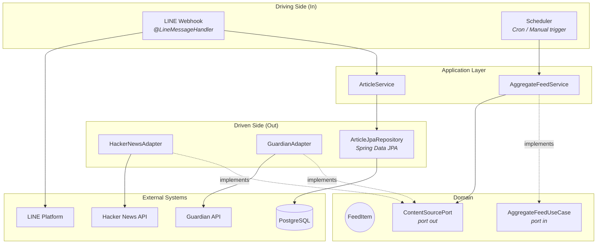
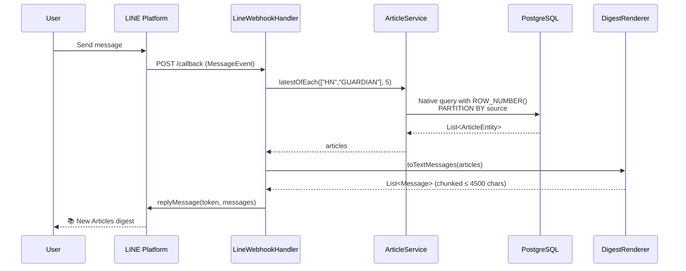

# Architecture Decision Records

Each technical choice is documented in its own ADR with context, decision, and consequences.

## Architecture

## Request Flow

When a user messages the LINE bot, here's what happens end to end:

## Decisions

- [ADR 0001: JPA / Hibernate](0001-jpa-hibernate.md)
- [ADR 0002: HikariCP](0002-hikaricp.md)
- [ADR 0003: Flyway](0003-flyway.md)
- [ADR 0004: OpenFeign](0004-openfeign.md)
- [ADR 0005: LINE Bot Webhook](0005-line-bot-webhook.md)
